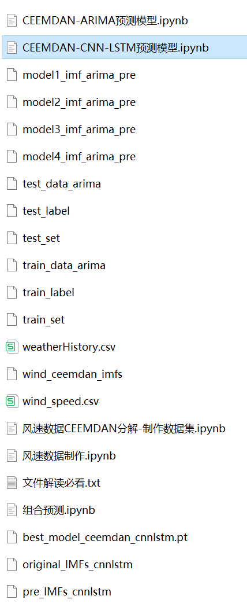
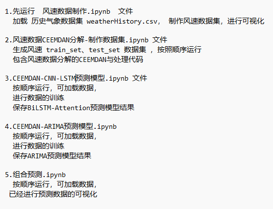
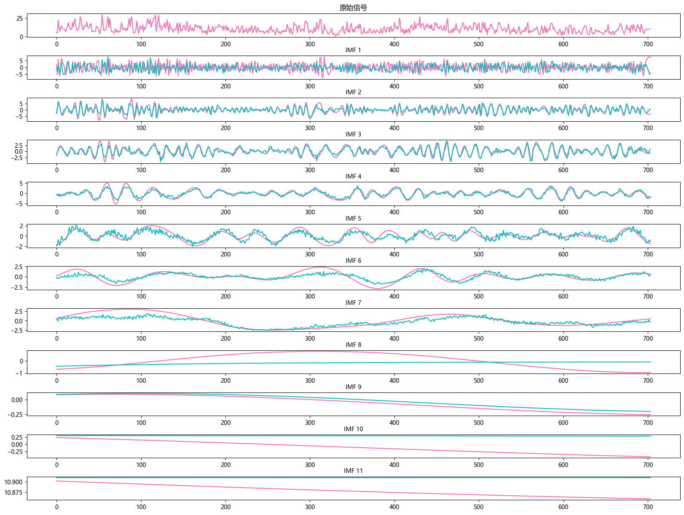

# CEEMDAN + Combination (CNN-LSTM+ARIMA) Prediction Model

The method of Comprehensive Ensemble Experience Mode Decomposition (CEEMDAN) and hybrid predictive models (CNN-LSTM + ARIMA) is proposed to enhance the prediction performance of time series data. The core of this method lies in the use of CEEMDAN algorithm for decomposing the time series, followed by modeling the decomposed data using CNN-LSTM and ARIMA models, and finally integrating the predictions from both models through an ensemble approach.
When dealing with LSTF problems, selecting the appropriate window size is crucial. The right choice of window size can help the model better capture patterns and features within time series. To extract longer dependencies for modeling sequences, this paper increases the window size to 96 and employs the CEEMDAN-CNN-LSTM model to fully extract feature information from high-frequency component sequences.
Include wind speed data, as well as the wind speed dataset and label set that have been generated and processed through CEEMDAN decomposition. The corresponding codes can be run, and there are also examples of CEEMDAN decomposition.
CNN-LSTM + ARIMA model, with smaller MSE and MAE, showing particularly significant results.
Includes code for data preprocessing with CEEMDAN, complete CNN-LSTM model prediction code, ARIMA prediction model code, and visualization code.
Environment: Python 3.9
\n        \n  
\n        \n      \n        \n  

## Images

<!-- PAYMENT_BLOCK -->

## Get this dataset

- Payment link (Stripe): [Buy now](https://buy.stripe.com/3cs8yP7sY87d0vu9AB)
- Payment QR code: 

<!-- /PAYMENT_BLOCK -->
